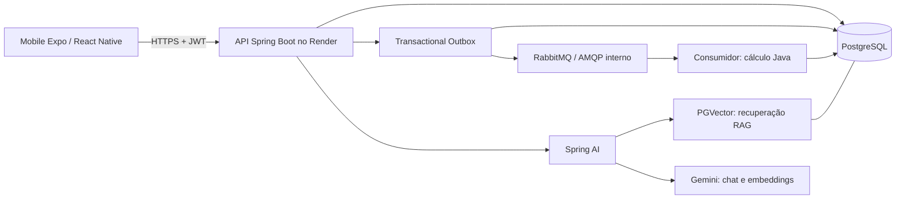
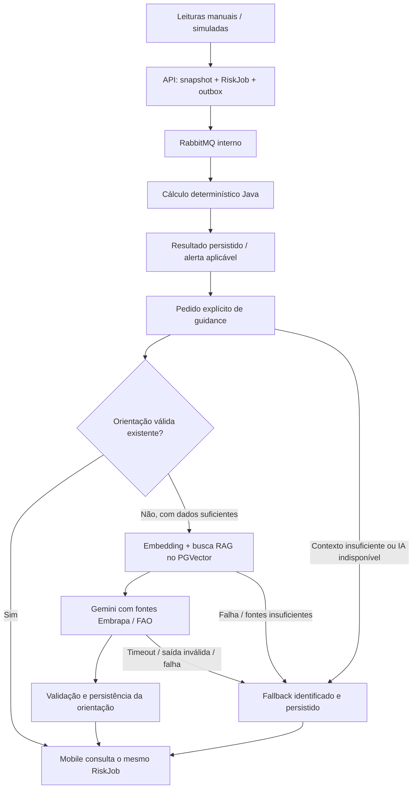

# AgroConecta — Entrega de IoT e Inteligência Artificial

Disciplina: Disruptive Architectures: IoT, IoB & Generative IA — Global Solution 2026/2.

O [GS-FINAL](https://github.com/deryksouza2006/GS-FINAL) é o repositório oficial desta entrega. O [AgroSolution](https://github.com/deryksouza2006/AgroSolution), desenvolvido com Expo e React Native, é a interface complementar. Este documento consolida os contratos e registros de avaliação existentes; sua preparação não executou testes, chamadas ao Gemini ou operações no banco de demonstração.

## 1. Visão geral

O AgroConecta reúne cadastros agrícolas, leituras, indicadores hídricos, alertas e orientações para pequenos produtores rurais. O problema atendido é a dificuldade de interpretar dados de umidade e condições ambientais para decidir sobre manejo hídrico. Uma leitura isolada, sem parâmetros do solo ou conhecimento das condições locais, não determina uma decisão de irrigação.

A contribuição para CitizenTech é facilitar o acesso a informação técnica e tornar visíveis os dados, as regras e as limitações usados na análise. O produtor continua responsável pela decisão, com apoio profissional quando necessário.

A proposta se relaciona ao **ODS 2**, pelo apoio informacional à agricultura sustentável; ao **ODS 9**, pela integração de infraestrutura digital e IA; e ao **ODS 13**, pela compreensão das condições hídricas e adaptação. Essas relações indicam a finalidade do projeto. Não foram medidos ganhos de produtividade, economia de água ou efeitos sobre o comportamento dos produtores.

## 2. Escopo da entrega

Os sensores apresentados são registros cadastrados e vinculados a talhões. As leituras podem ser **manuais ou simuladas**, com origem identificada. Não há ESP32 físico, MQTT, dados de satélite, sensores calibrados em campo ou validação agronômica de campo nesta entrega.

**RabbitMQ é mensageria interna**, utilizada entre a API e seus consumidores assíncronos por AMQP. Ele não representa uma conexão MQTT com equipamentos. A API possui contrato de ingestão externa com chave de dispositivo, mas isso não comprova integração física.

A ausência de hardware não impede a demonstração do fluxo: leituras registradas ou simuladas percorrem a validação, o cálculo determinístico, os alertas e a orientação por IA. O enunciado da disciplina avalia IA generativa integrada e aprofundamento técnico; hardware físico não é requisito obrigatório. O aprofundamento escolhido foi RAG básico.

## 3. Funcionalidades utilizadas na entrega

| Funcionalidade | Uso na demonstração |
| --- | --- |
| Propriedades e talhões | Organizar os cultivos e restringir os recursos ao produtor. |
| Perfil agronômico | Registrar parâmetros do solo, capacidade de campo e ponto de murcha, com revisões preservadas. |
| Sensores e saúde | Cadastrar sensores e consultar comunicação, bateria, manutenção e saúde calculada por critérios demonstrativos. |
| Leituras agrícolas | Registrar e consultar medições, datas e origem, sem apresentar dados ausentes como zero. |
| Simulação identificada | Produzir cenários de demonstração com origem `SIMULATED`, mediante habilitação explícita. |
| Diário agrícola | Registrar atividades por talhão; tipos e datas recentes podem compor o contexto da orientação. |
| RiskJob | Capturar as entradas e executar o cálculo hídrico de forma assíncrona. |
| Alertas | Apresentar risco e justificativa, com reconhecimento e resolução administrativos. |
| Dashboard | Reunir indicadores, cultivos, leituras, atividades, alertas e processamentos. |
| Guidance | Solicitar orientação estruturada com Gemini e fontes recuperadas por RAG. |

Os endpoints essenciais são `POST /api/sensor-readings`, para entrada manual; `POST /api/crop-areas/{id}/sensor-readings/simulate`, para simulação de demonstração; `POST /api/crop-areas/{id}/risk-jobs`, sem body e com retorno 202; `GET /api/risk-jobs/{id}`, para consultar o estado; e `POST /api/risk-jobs/{id}/guidance`, sem body, para gerar ou reutilizar a orientação. O POST de guidance retorna o RiskJob com orientação ou fallback; se o cálculo ainda não terminou, retorna 409. Os demais contratos permanecem no [mapa da API](https://github.com/deryksouza2006/GS-FINAL/blob/main/README.md#mapa-da-api).

## 4. Arquitetura

O mobile Expo/React Native autentica o produtor e consome a API Spring Boot. PostgreSQL mantém os dados agrícolas, os snapshots e as orientações; PGVector realiza a recuperação semântica do corpus institucional no mesmo banco. Spring AI integra chat e embeddings ao Gemini.

O padrão **Transactional Outbox** grava o evento junto à operação de negócio. Um publicador encaminha os eventos ao RabbitMQ, e consumidores executam o processamento. Confirmações, idempotência e mecanismos limitados de recuperação tratam falhas de entrega. Esses mecanismos de mensageria são independentes da política de tentativa única da guidance.

A API está publicada no Render. O registro de 17/11/2026 informa health, Swagger e OpenAPI com HTTP 200, PostgreSQL 16.15 com 19 migrations aplicadas e CloudAMQP por TLS na porta 5671. São verificações históricas; os endereços públicos e as condições do ambiente estão no [README](https://github.com/deryksouza2006/GS-FINAL/blob/main/README.md#links-da-entrega).

O JWT identifica o usuário autenticado; os serviços validam seu estado e a propriedade dos recursos. O cliente não seleciona livremente um proprietário para consultar jobs ou enviar contexto ao modelo.

## 5. Fluxo completo

1. O produtor cadastra uma propriedade e um talhão.
2. Configura o perfil agronômico do talhão.
3. Cadastra um sensor vinculado ao cultivo.
4. Registra uma leitura manual ou solicita uma simulação identificada.
5. Solicita um RiskJob para o talhão.
6. A API salva o snapshot das entradas e o evento de outbox na mesma transação.
7. O publicador encaminha o evento ao RabbitMQ, que entrega o processamento ao consumidor.
8. O Java calcula o risco hídrico por regras determinísticas.
9. O resultado e, quando aplicável, o alerta são persistidos.
10. O usuário solicita a guidance. Se já houver orientação válida, a API a reutiliza.
11. Para uma nova orientação elegível, a consulta é convertida em embedding e o PGVector recupera passagens e fontes.
12. O Gemini recebe o resultado fixo e o contexto necessário e gera a orientação estruturada.
13. A API valida a saída, fixa o risco pelo resultado Java e persiste a guidance. Falhas seguem o caminho de contingência.
14. O mobile exibe o risco, a orientação, os avisos e as fontes do mesmo job.

## 6. Separação entre regras e IA

**O risco hídrico é calculado pelo Java e não pode ser alterado pela IA.** O resultado persistido em `result.riskLevel` é a classificação oficial. O cálculo usa as medições e os parâmetros capturados no job; não depende de uma resposta do Gemini.

A IA explica o resultado e sugere ações de conferência ou manejo responsável. A aplicação copia o risco oficial para a guidance e repete essa proteção no serviço de persistência, sob bloqueio do job do proprietário. Mesmo que o modelo sugira outro nível, ele não substitui o resultado, as medições, os limiares ou o estado administrativo do alerta.

Guidance válida tem `fallback=false`, é gravada em `risk_jobs.guidance` como JSONB e pode ser recuperada por GET. Um novo pedido para o mesmo job reutiliza a orientação válida sem nova busca RAG ou geração. Outra condição de cultivo exige uma nova análise, com novas entradas.

Quando a orientação falha, a API grava `fallback=true`, motivo explícito e texto de contingência. Isso mantém o resultado determinístico acessível; não representa geração válida. Um resultado `INSUFFICIENT_DATA` produz `INSUFFICIENT_CONTEXT`, sem chamar RAG ou Gemini, e não é convertido em risco normal. Fallback pode ser substituído em uma tentativa manual posterior. Uma falha concorrente tardia não sobrescreve guidance válida.

**Não existe retry automático de guidance nas camadas do provedor.** Após timeout ou incerteza de rede, deve-se consultar o mesmo job antes de solicitar outra geração. Outbox, consumidores e fluxo legado possuem políticas próprias de recuperação; essa afirmação não se aplica a toda a mensageria. Os locks protegem a persistência, mas não comprovam deduplicação de chamadas externas iniciadas simultaneamente antes da primeira gravação.

## 7. Inteligência artificial

| Item | Configuração utilizada |
| --- | --- |
| Integração | Spring AI 2.0.2, Google GenAI Developer API. |
| Geração | `gemini-3.5-flash-lite`. |
| Embedding | `gemini-embedding-001`, com 768 dimensões. |
| Resposta | JSON estruturado convertido para `AgronomicAdvice`, temperatura 0,2 e Google Search desativado. |
| Validação | Conversão JSON e Jakarta Validation: campos obrigatórios, enums e limites de tamanho. Fontes públicas vêm da recuperação RAG. |
| Timeout da tarefa | 90 segundos por padrão, abrangendo recuperação RAG e geração; não são dois prazos consecutivos de 90 segundos. |
| Transporte e repetição | Cliente Google com uma tentativa e timeout; composição Spring AI sem retries de guidance. |
| Persistência | Orientação válida e fallback gravados no job por serviço transacional restrito ao proprietário. |

O prompt de sistema versionado orienta resposta em português, uso exclusivo dos dados e evidências fornecidos e indicação de informações ausentes. Ele proíbe inventar clima, chuva, características do solo e fontes, recomendar dosagens de agrotóxicos ou acionar irrigação. O arquivo é [agronomic-analysis-v1.txt](https://github.com/deryksouza2006/GS-FINAL/blob/main/src/main/resources/prompts/agronomic-analysis-v1.txt), com versão `agronomic-v1` registrada na orientação.

O DTO limita resumo a 2.000 caracteres, recomendação a 4.000 e listas do modelo a dez textos de até 500 caracteres. Esses controles validam a estrutura, não a veracidade agronômica. A aplicação pode acrescentar avisos determinísticos à orientação final.

Os motivos de contingência são `PROVIDER_UNAVAILABLE`, `CALL_TIMEOUT`, `INVALID_STRUCTURED_OUTPUT`, `NO_RELEVANT_SOURCES` e `INSUFFICIENT_CONTEXT`. Mensagens brutas de erro não são exibidas ao produtor. O cancelamento por timeout tenta interromper a tarefa, mas não garante que uma requisição já recebida pelo provedor deixe de ser processada.

O prazo de cinco minutos de `AI_PROCESSING_TIMEOUT` pertence à reserva do fluxo legado e não amplia o prazo da guidance. No contrato de integração, o mobile usa timeout de 180 segundos e não repete automaticamente o POST.

## 8. RAG e fontes

RAG significa recuperar conteúdo antes de gerar a resposta. No AgroConecta, passagens agronômicas são buscadas por similaridade e enviadas ao Gemini junto ao resultado fixo do job. Não há pesquisa aberta na internet nem treinamento de um modelo próprio. PGVector foi escolhido para manter a busca vetorial no PostgreSQL já utilizado, sem acrescentar outro banco; não houve benchmark comparativo entre soluções.

O corpus contém quatro sínteses locais em palavras próprias, com referências institucionais, em [rag/agronomy](https://github.com/deryksouza2006/GS-FINAL/blob/main/src/main/resources/rag/agronomy). Não são cópias integrais dos sites. Os metadados registram identificador, título, instituição, URL, tema, versão e data de acesso. A inclusão das referências não significa endosso do AgroConecta pelas instituições.

| Instituição | Título registrado e referência |
| --- | --- |
| Embrapa | [Manejo de irrigação do milho](https://www.embrapa.br/en/web/agencia-de-informacao-tecnologica/cultivos/milho/producao/irrigacao/manejo) |
| Embrapa | [Umidade do solo na agricultura familiar](https://www.infoteca.cnptia.embrapa.br/handle/doc/974063) |
| Embrapa | [Desenvolvimento do milho e disponibilidade de água](https://www.embrapa.br/web/agencia-de-informacao-tecnologica/cultivos/milho/pre-producao/caracteristicas-da-especie-e-relacoes-com-o-ambiente/caracteristicas-da-planta) |
| FAO | [Gestão de água e irrigação](https://www.fao.org/land-water/water/agricultural-water-management/irrigation/en) |

O carregador divide o conteúdo em fragmentos de até 1.000 caracteres, respeitando pares UTF-16. Cada fragmento recebe UUID determinístico a partir da fonte, versão e posição. O checksum SHA-256 inclui texto, modelo de embedding e dimensão 768. Conteúdo inalterado é ignorado na carga; alterações atualizam os fragmentos da fonte. Uma instalação vazia exige ingestão e pode consumir chamadas de embedding, enquanto uma consulta nova usa um embedding de consulta, sem reingerir os quatro documentos.

Os vetores ficam em `agronomy_vector_store`, com `vector(768)` e índice HNSW por cosseno. `rag_ingestion` controla checksums e atualização. A recuperação padrão usa `top-k=4`, limiar de similaridade 0,3 e filtro de corpus agronômico. São aceitas apenas passagens não vazias, com atribuição e URLs HTTP(S) sem credenciais. Pelo menos três passagens elegíveis são exigidas para gerar guidance; isso não garante três fontes distintas ou relevância agronômica universal.

Cada passagem enviada é limitada a 1.600 caracteres. O cliente separa instruções de sistema do JSON com `untrustedFieldData` e `institutionalEvidence`, com limite de 16.000 caracteres para o contexto serializado. São enviados somente dados necessários à interpretação do job, sem descrições livres do diário ou dados de outros produtores.

## 9. Dados utilizados

| Entrada | Uso e cuidado de interpretação |
| --- | --- |
| Temperatura e umidade do ar | Apoiam o cálculo de VPD e a interpretação das condições ambientais; ausência é explicitada. |
| Umidade do solo | Apoia disponibilidade hídrica e tendência, conforme perfil e validade das leituras. Percentual isolado não determina lâmina de irrigação. |
| Chuva | Registrada com intervalo e data; acumulados indicam cobertura parcial ou indisponível quando aplicável. Não é inventada pelo modelo. |
| Bateria | Informação operacional do sensor; não equivale a um indicador agronômico nem é enviada como medição no contexto atual de guidance. |
| Data da medição | Permite avaliar atualidade e intervalos; datas e origem acompanham a leitura. |
| Perfil agronômico | Fornece parâmetros como capacidade de campo e ponto de murcha; a revisão usada permanece no snapshot. |
| Atividades recentes | Tipos e datas de atividades do próprio talhão ajudam a contextualizar a orientação, sem enviar a descrição livre. |
| Limiares configurados | Definem regras determinísticas e sua versão; ficam preservados no job para explicar o resultado. |

Os padrões demonstrativos `demo-v1` incluem disponibilidade crítica de 20%, atenção de 40%, VPD de 2 kPa, secagem rápida de −3 pontos percentuais por hora e validade de 24 horas para as leituras. Não são limites agronômicos universais. Perfil e medições precisam de base e calibração compatíveis.

Valores simulados permanecem identificados como **`SIMULATED`**, inclusive no histórico e nos avisos. Parâmetros demonstrativos e origem simulada são conceitos diferentes: uma leitura manual não se torna simulada por usar regras de demonstração. Também não comprova aquisição física apenas por ter `simulated=false`.

## 10. Segurança e privacidade

- **JWT e autorização:** a API valida o token e o produtor ativo. Consultas e gravações respeitam a propriedade; recursos inexistentes e de outro produtor retornam o mesmo 404, sem revelar IDs alheios.
- **Credenciais:** a chave Google pertence somente ao ambiente do backend. Ela não deve aparecer no GitHub, no mobile, em logs ou capturas. O aplicativo usa a própria sessão para falar com a API, sem receber a chave do provedor.
- **Dispositivos:** a API armazena somente o hash da chave de dispositivo; o valor é mostrado na criação ou rotação. A existência do contrato não comprova equipamento conectado.
- **Contexto mínimo:** a guidance usa o snapshot e atividades autorizadas, sem nome do produtor, credenciais, código do dispositivo, descrições livres ou dados alheios. A proveniência manual é confirmada no escopo do proprietário.
- **Saída e erros:** a resposta passa por conversão e validação. O backend fixa risco e fontes, acrescenta avisos e sanitiza erros; JSON bruto inválido e stack traces não são conteúdo público.
- **Prompt injection:** campos e passagens recuperadas são serializados como dados não confiáveis, separados da mensagem de sistema. Instruções encontradas nesses dados não recebem autoridade para redefinir risco ou comportamento. Isso reduz o risco, sem assegurar resistência absoluta a toda entrada adversarial.

A auditoria registrada não encontrou chaves Google ou tokens literais nos arquivos próprios examinados. Essa evidência histórica e os testes locais não constituem certificação de segurança nem análise completa de invasão.

## 11. Testes e evidências

### Coleta executada em 18/11/2026

Os [relatórios de execução](evidencias/README.md) incluem resultados por caso dos testes Java
e verificação HTTP da API realizados em 18/11. O registro de sucesso da orientação real
de 17/11 está incluído com sua data e origem preservadas.

O README registra a execução completa final da API em **17/11/2026**, com Java 21: **21 suítes, 182 testes descobertos, 181 aprovados, um teste manual ignorado, zero falhas e zero erros**. O teste ignorado é `GeminiManualTests.realGeminiReturnsValidStructuredAdviceWithInstitutionalSources`, habilitado apenas deliberadamente. A suíte comum não faz chamadas Google reais e utiliza ambientes descartáveis para banco e broker.

A auditoria de 15/11 já registrava 182 testes. O relatório da integração de 14/11 registrava 178, contagem histórica anterior às correções posteriores. Os **105 testes do mobile** são igualmente um resultado histórico, anterior à remoção da pasta de testes daquele repositório; não são testes existentes na versão final do mobile.

A validação externa de **14/11/2026, concluída às 23:41 −03**, realizou uma diagnóstica de chat e uma geração pelo fluxo real de guidance, além de um embedding de consulta: **duas chamadas de chat, um embedding e nenhuma reingestão**. A diagnóstica retornou HTTP 200 e JSON válido; POST e GET do mesmo job também retornaram 200, com orientação idêntica, `fallback=false`, risco `CRITICAL`, alerta `OPEN` e estado `COMPLETED`.

| Cenário e condição | Critério de aceitação | Evidência existente | Limite da comprovação |
| --- | --- | --- | --- |
| Inicialização sem chave Google, IA desligada | Iniciar sem clientes externos. | `AiConfigurationTests.disabledAiStartsWithoutKeyAndBindsDefinitiveDefaultsToGoogleGenai`. | Não demonstra disponibilidade do provedor. |
| Cálculo determinístico | Regras, fronteiras e dados ausentes tratados sem Gemini. | `WaterRiskCalculatorTests`, `WaterIndicatorsTests`; teste `deterministicRiskAndInclusiveBoundary`. | Não valida calibração agronômica em campo. |
| Integração Gemini real | Modelo configurado e saída estruturada válida. | Diagnóstica externa de 14/11: HTTP 200, `structuredValid=true`, modelo `gemini-3.5-flash-lite`. | Execução pontual, não garantia de disponibilidade futura. |
| Recuperação das quatro fontes | Referências atribuídas e vetores compatíveis. | Verificação do banco com `vector(768)` e quatro fontes; a guidance real também contém as três referências Embrapa e a FAO. | Consulta SQL isolada não comprovaria embedding externo; não se garante quatro fontes em toda consulta. |
| Orientação válida | JSON aceito com `fallback=false`. | POST real 200 e `RagAndPromptTests.structuredOutputKeepsInjectionInsideDataAndSearchDisabled`. | Estrutura válida não prova correção de cada afirmação. |
| Persistência | GET devolve o conteúdo gravado pelo POST. | Validação real: `persistedExactly=true`; `RiskJobGuidanceIntegrationTests.postFallbackIsCommittedAndGetReturnsExactlyThePersistedJson` verifica fallback persistido. | O resumo `persistedExactly` é do roteiro de avaliação, não um campo do contrato HTTP. |
| Reutilização sem nova chamada | Novo POST para guidance válida mantém o contador do cliente. | `RiskJobGuidanceIntegrationTests.explicitRetryReplacesFallbackAndSuccessIsPersistedAndReused`. | Cliente local controlado; não houve geração real adicional para demonstrar reuso. |
| Provedor indisponível | Fallback `PROVIDER_UNAVAILABLE`, sem alterar risco. | `JobGuidanceTests.unavailableProviderFallsBackWithoutChangingRisk` e teste de persistência de fallback. | Falha induzida, sem provocar indisponibilidade real do Google. |
| Timeout | Fallback `CALL_TIMEOUT`. | `JobGuidanceTests.timeoutReturnsFallback` e `providerTransportTimeoutAlsoUsesCallTimeout`. | Tempos reduzidos e controlados, sem medição de latência real. |
| Saída estruturada inválida | Rejeitar saída e sanitizar o erro. | `invalidStructuredOutputHasItsOwnReason`, em `JobGuidanceTests`, e `invalidJsonIsClassifiedWithoutLeakingTheProviderOutput`, em `RagAndPromptTests`. | Não é um caso de JSON inválido obtido de chamada externa real. |
| Contexto insuficiente | `INSUFFICIENT_CONTEXT`, sem RAG nem geração. | `JobGuidanceTests.insufficientContextDoesNotRetrieveOrGenerate`. | Parte de resultado `INSUFFICIENT_DATA` controlado. |
| Fontes insuficientes | `NO_RELEVANT_SOURCES`, sem geração. | `JobGuidanceTests.noSourcesDoesNotInvokeModel`; exclusão de URLs inseguras em `RagAndPromptTests`. | Não é avaliação estatística da relevância de consultas diversas. |
| Concorrência | Guidance válida prevalece sobre fallback tardio; snapshot íntegro. | `RiskJobGuidanceIntegrationTests.concurrentFallbackAndSuccessCannotDowngradeValidGuidanceOrSnapshots`. | Verifica integridade local, não capacidade sob carga ou deduplicação global de chamadas. |
| Isolamento entre produtores | Negar acesso alheio e impedir contexto com dados de outro produtor. | `otherOwnerCannotReadGenerateOrSaveGuidance` e `promptContextUsesOnlyOwnedSnapshotAndActivityTypesNotOtherProducers`, em `RiskJobGuidanceIntegrationTests`. | Dados de teste isolados, não certificação de segurança. |
| Preservação do risco | Ignorar risco sugerido pelo modelo e manter o valor Java. | `onlyRetrievedSourcesReturnedAndModelCannotChangeRisk`, em `JobGuidanceTests`, e `serviceAlwaysCopiesRiskFromLockedDeterministicResult`, em `RiskJobGuidanceIntegrationTests`; execução real manteve `CRITICAL`. | Preservar a regra não valida seus limiares para qualquer solo ou cultura. |
| Prompt injection | Passagens permanecem em dados e risco continua protegido. | `RagAndPromptTests.structuredOutputKeepsInjectionInsideDataAndSearchDisabled`. | Verifica composição do prompt e autoridade da saída; não garante obediência absoluta do modelo. |

As implementações e os testes citados permanecem no [repositório principal da API](https://github.com/deryksouza2006/GS-FINAL): [testes de guidance](https://github.com/deryksouza2006/GS-FINAL/blob/main/src/test/java/br/com/fiap/citizentech/water/JobGuidanceTests.java), [persistência e isolamento](https://github.com/deryksouza2006/GS-FINAL/blob/main/src/test/java/br/com/fiap/citizentech/water/RiskJobGuidanceIntegrationTests.java), [RAG e prompt](https://github.com/deryksouza2006/GS-FINAL/blob/main/src/test/java/br/com/fiap/citizentech/analysis/RagAndPromptTests.java) e [configuração](https://github.com/deryksouza2006/GS-FINAL/blob/main/src/test/java/br/com/fiap/citizentech/analysis/config/AiConfigurationTests.java). Os nomes de métodos permitem localizar as asserções sem reproduzir dados de contas. Resultados históricos não garantem disponibilidade futura do provedor. Nenhum teste foi reexecutado nesta consolidação.

## 12. Resultados comprovados

A validação real registrada confirmou embeddings compatíveis com o índice de 768 dimensões, recuperação das quatro referências, orientação estruturada válida e persistência por comparação entre POST e GET. Resultado, medições, limiares, chuva, perfil e estado do alerta permaneceram iguais após a geração.

Os testes locais comprovam reutilização sem aumentar chamadas do cliente controlado, fallback persistido, prioridade da orientação válida na concorrência, isolamento entre produtores e preservação do risco. O funcionamento assíncrono possui evidência em `ReadingRabbitIntegrationTests`, que usa RabbitMQ descartável para publicação, confirmações, consumo e retry/DLQ; `OutboxUnitTests` cobre o publicador e `WaterWorkflowIntegrationTests` verifica perfil, propriedade e snapshot do RiskJob. Não se atribui a esses testes uma demonstração de hardware físico.

Essas evidências verificam contratos e controles técnicos. Não comprovam aumento de produtividade, economia de água, eficácia agronômica em campo ou qualidade universal das recomendações.

## 13. Limitações

- O corpus tem quatro sínteses, com cobertura limitada de culturas, solos, regiões e estádios de desenvolvimento; não há atualização automática das fontes na web.
- Não houve validação agronômica independente, integração com sensor físico calibrado ou estudo de uso com produtores.
- Rede, disponibilidade e cotas do Gemini afetam a geração; não há garantia demonstrada de latência, custo ou escala de produção.
- A IA pode produzir afirmações inadequadas mesmo com RAG e JSON válido; instruções contra prompt injection não eliminam todo risco.
- Leituras e parâmetros demonstrativos não substituem calibração e observação local. Avisos corrigidos de proveniência aplicam-se a novas gerações; orientações históricas persistidas podem conservar formulações anteriores e não comprovam aquisição física.
- Não há acionamento automático de irrigação. A orientação é apoio à decisão e **não substitui um engenheiro agrônomo**.
- A validação HTTP não substitui validação manual da navegação, acessibilidade e interação no aplicativo.
- O registro de deploy de 17/11 informa suspensão por inatividade no plano gratuito do Render e expiração prevista do PostgreSQL gratuito em 17/12/2026. Continuidade exige confirmar e manter a infraestrutura, conforme o README.

## 14. Execução e demonstração

A configuração técnica, as variáveis e os comandos permanecem no [README principal](https://github.com/deryksouza2006/GS-FINAL/blob/main/README.md#execução-local). Credenciais devem ser fornecidas pelo ambiente seguro. Para geração externa, o acesso ao modelo e a carga do corpus precisam estar preparados; iniciar sem IA externa continua permitido.

1. Iniciar PostgreSQL/PGVector e RabbitMQ conforme o ambiente local, ou confirmar a infraestrutura publicada.
2. Iniciar a API com as variáveis apropriadas e conferir o health check.
3. Entrar no mobile AgroSolution com a API configurada.
4. Abrir um talhão do produtor autenticado com perfil agronômico e sensor cadastrados.
5. Criar ou consultar leituras suficientes para a análise; usar simulação apenas em ambiente de demonstração habilitado e manter sua identificação.
6. Solicitar um RiskJob e acompanhar o processamento pelo ID retornado.
7. Consultar o resultado determinístico e eventual alerta.
8. Solicitar guidance quando o job tiver resultado; se já houver orientação válida, a API a reutiliza.
9. Conferir recomendação, avisos, fontes e eventual indicação de fallback.
10. Reabrir o mesmo job por GET para comprovar a persistência, sem criar outra análise ou repetir geração desnecessariamente.

Se a IA falhar, mostrar o risco e a contingência identificada. Uma orientação válida previamente persistida pode demonstrar o resultado histórico, deixando claro que sua consulta não comprova uma chamada nova ao provedor. O roteiro de [validação externa controlada](https://github.com/deryksouza2006/GS-FINAL/blob/main/README.md#teste-manual-real-controlado) permanece separado da demonstração cotidiana.

## 15. Conclusão

O AgroConecta entrega um fluxo de acompanhamento agrícola em que o Java calcula o risco hídrico e a IA o explica com referências recuperadas. A orientação é validada, persistida e reutilizada; falhas mantêm o resultado determinístico e apresentam contingência. A demonstração funciona com leituras manuais ou simuladas, dentro dos limites técnicos e agronômicos documentados.

##

Repositório principal — API e Inteligência Artificial:
https://github.com/deryksouza2006/GS-FINAL

Aplicativo mobile:
https://github.com/deryksouza2006/AgroSolution

API publicada:
https://agroconecta-api-ms1a.onrender.com

Swagger:
https://agroconecta-api-ms1a.onrender.com/swagger-ui/index.html

Vídeo da solução:
[PREENCHER]
