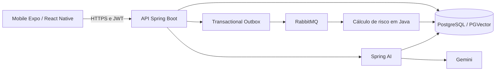

# AgroConecta — IoT e Inteligência Artificial

Global Solution 2026/2 · Disruptive Architectures: IoT, IoB & Generative IA

## Integrantes

| Nome | RM |
| --- | --- |
| Lucas Gonçalves Viana | 563254 |
| Deryk de Souza Queiroz | 563412 |
| Vinicius Paschoeto da Silva | 563089 |
| Felipe Wiclif Leal da Silva | 563901 |

## Links da entrega

| Recurso | Link |
| --- | --- |
| IoT e IA | [IOT_AI](https://github.com/deryksouza2006/IOT_AI) |
| Código da API e da IA | [GS-FINAL](https://github.com/deryksouza2006/GS-FINAL) |
| Aplicativo mobile | [AgroSolution](https://github.com/deryksouza2006/AgroSolution) |
| API publicada | [AgroConecta no Render](https://agroconecta-api-ms1a.onrender.com) |
| Swagger | [Documentação interativa](https://agroconecta-api-ms1a.onrender.com/swagger-ui/index.html) |
| OpenAPI | [Contrato da API](https://agroconecta-api-ms1a.onrender.com/v3/api-docs) |
| Disponibilidade | [Health check](https://agroconecta-api-ms1a.onrender.com/actuator/health) |
| Evidências | [Relatórios de testes e integração](evidencias/README.md) |

## O projeto

O AgroConecta ajuda pequenos produtores a acompanhar a umidade do solo e as condições ambientais dos cultivos. O aplicativo reúne leituras, histórico de atividades e alertas. Ao abrir uma análise, o produtor pode pedir uma explicação do resultado com referências da Embrapa e da FAO.

A proposta se relaciona aos ODS 2, 9 e 13 pelo apoio à agricultura sustentável, à infraestrutura digital no campo e ao acompanhamento das condições hídricas. A economia de água e os ganhos de produtividade ainda precisam ser avaliados com produtores.

Este repositório reúne a documentação e as evidências da disciplina. A implementação de sensores, indicadores, alertas, Spring AI e RAG fica no GS-FINAL. O AgroSolution é o aplicativo Expo/React Native que consome a API.

## Sensores e análise hídrica

Os sensores são cadastrados por talhão e recebem leituras manuais ou simuladas. Cada leitura mantém sua origem, data e valores. A demonstração utiliza sensores simulados e parâmetros de solo identificados como demonstrativos.

| Dados | Uso |
| --- | --- |
| Temperatura e umidade do ar | Cálculo do déficit de pressão de vapor, em kPa |
| Umidade do solo | Disponibilidade hídrica e tendência de secagem |
| Chuva | Acumulados por período, quando há intervalos de medição válidos |
| Bateria e horário da leitura | Saúde e comunicação do sensor |
| Perfil agronômico | Capacidade de campo, ponto de murcha e revisão usada na análise |
| Atividades agrícolas | Contexto de irrigação, adubação, plantio e colheita |

O Java calcula os indicadores e classifica o risco como `NORMAL`, `ATTENTION`, `CRITICAL` ou `INSUFFICIENT_DATA`. As entradas e os limiares ficam salvos no RiskJob para consulta do histórico.

As regras `demo-v1` usam disponibilidade crítica de 20%, atenção de 40%, VPD de 2 kPa, secagem rápida de −3 pontos percentuais por hora e validade de 24 horas para as leituras. A aplicação em campo exige calibração e parâmetros adequados ao solo e à cultura.

## Arquitetura

A API grava o evento junto com o job por Transactional Outbox. O RabbitMQ entrega o processamento ao consumidor, que calcula o resultado e o salva no PostgreSQL. A mensageria usa AMQP entre os serviços.

O produtor solicita a orientação depois que a análise termina. A API recupera o contexto do job, busca as referências no PGVector e envia os dados ao Gemini por Spring AI. A orientação validada fica salva no mesmo job e pode ser reaberta pelo aplicativo.

## Orientação com IA

Escolhemos RAG para fornecer referências agronômicas ao modelo e apresentar as fontes ao produtor. O PGVector aproveita o PostgreSQL já utilizado pela aplicação.

| Configuração | Valor |
| --- | --- |
| Integração | Spring AI 2.0.2 e Google GenAI Developer API |
| Modelo de geração | `gemini-3.5-flash-lite` |
| Embeddings | `gemini-embedding-001`, 768 dimensões |
| Saída | JSON convertido para `AgronomicAdvice` e validado com Jakarta Validation |
| Temperatura | 0,2 |
| Timeout da orientação | 90 segundos para recuperação e geração |
| Tentativas do provedor | Uma por solicitação de orientação |

O contexto inclui a cultura, o resultado calculado, as leituras do job, os parâmetros do perfil e os tipos e datas de atividades recentes. O prompt `agronomic-v1` pede uma resposta em português, com recomendações de conferência e avisos sobre os dados disponíveis.

O risco exibido vem de `result.riskLevel`. O backend fixa esse valor na orientação e monta a lista de fontes a partir dos documentos recuperados. As regras do prompt também restringem diagnósticos, dosagens de defensivos e comandos de irrigação.

Quando a geração falha, a resposta contém `fallback=true`, um motivo e um texto de contingência. O resultado hídrico continua disponível. Os motivos previstos são `PROVIDER_UNAVAILABLE`, `CALL_TIMEOUT`, `INVALID_STRUCTURED_OUTPUT`, `NO_RELEVANT_SOURCES` e `INSUFFICIENT_CONTEXT`.

Uma orientação válida é reutilizada em pedidos posteriores. Depois de um timeout, o cliente consulta o mesmo job antes de tentar novamente. O serviço protege a persistência com bloqueio e mantém a orientação válida caso chegue um fallback concorrente.

## Acervo RAG

O acervo contém quatro sínteses locais, com metadados de título, instituição, URL, tema, versão e data de acesso. Os arquivos estão em `src/main/resources/rag/agronomy` no GS-FINAL.

| Instituição | Referência |
| --- | --- |
| Embrapa | [Manejo de irrigação do milho](https://www.embrapa.br/en/web/agencia-de-informacao-tecnologica/cultivos/milho/producao/irrigacao/manejo) |
| Embrapa | [Umidade do solo na agricultura familiar](https://www.infoteca.cnptia.embrapa.br/handle/doc/974063) |
| Embrapa | [Desenvolvimento do milho e disponibilidade de água](https://www.embrapa.br/web/agencia-de-informacao-tecnologica/cultivos/milho/pre-producao/caracteristicas-da-especie-e-relacoes-com-o-ambiente/caracteristicas-da-planta) |
| FAO | [Gestão de água e irrigação](https://www.fao.org/land-water/water/agricultural-water-management/irrigation/en) |

O carregador divide os textos em trechos de até 1.000 caracteres. IDs determinísticos e checksums controlam a atualização do acervo. Os vetores usam 768 dimensões e índice HNSW por cosseno.

A recuperação busca até quatro trechos, com similaridade mínima de 0,3 e filtro do acervo agronômico. Para gerar uma orientação, exige pelo menos três passagens válidas e atribuídas. Cada passagem enviada ao modelo tem limite de 1.600 caracteres, dentro de um contexto total de até 16.000 caracteres.

O prompt trata os documentos recuperados e os campos da aplicação como conteúdo não confiável. As instruções ficam na mensagem de sistema. A aplicação descarta referências sem atribuição ou com URLs inválidas.

## Testes e evidências

Em **18/11/2026**, executamos `mvn -B verify` com Java 21 e Maven 3.9.16. O build terminou com sucesso.

| Verificação | Resultado |
| --- | --- |
| Suítes Java | 21 |
| Testes descobertos | 182 |
| Aprovados | 181 |
| Teste manual ignorado | 1 |
| Falhas e erros | 0 |
| Health, Swagger e OpenAPI | HTTP 200 |

Os testes comuns usam clientes de IA controlados e PostgreSQL/PGVector e RabbitMQ descartáveis. Cobrem cálculo dos indicadores, autorização, persistência, concorrência, fontes, timeout e fallback. O teste manual do Gemini depende de habilitação e chave de acesso.

O registro da execução real de **17/11/2026** contém uma orientação do modelo `gemini-3.5-flash-lite` com `fallback=false`, quatro fontes e risco `CRITICAL` preservado. Os relatórios registram as datas e o escopo de cada verificação. [Evidências completas](evidencias/README.md)

## Execução e demonstração

Clone o GS-FINAL e configure as variáveis descritas em seu README. O ambiente usa Java 21, PostgreSQL com PGVector e RabbitMQ. A geração real requer `APP_AI_ENABLED=true`, acesso ao modelo e `GOOGLE_API_KEY` no ambiente do backend. [Instruções de instalação](https://github.com/deryksouza2006/GS-FINAL#execução-local)

Para demonstrar o fluxo no aplicativo

1. Entrar com um produtor e abrir um talhão com perfil agronômico e sensor cadastrados.
2. Registrar leituras ou executar uma simulação em ambiente habilitado.
3. Solicitar a análise e acompanhar o RiskJob.
4. Abrir os indicadores e o alerta gerado.
5. Solicitar a orientação e conferir a recomendação, os avisos e as fontes.
6. Reabrir o mesmo job para consultar o conteúdo persistido.

| Operação | Endpoint |
| --- | --- |
| Registrar leitura manual | `POST /api/sensor-readings` |
| Simular cenário | `POST /api/crop-areas/{id}/sensor-readings/simulate` |
| Solicitar análise | `POST /api/crop-areas/{id}/risk-jobs` |
| Consultar análise | `GET /api/risk-jobs/{id}` |
| Solicitar orientação | `POST /api/risk-jobs/{id}/guidance` |

Análise e orientação recebem POST sem corpo. A criação da análise retorna 202. A orientação retorna o job com a guidance e responde 409 quando o cálculo ainda está pendente. As operações exigem JWT de produtor ativo e respeitam a propriedade dos recursos.

## Cuidados e limitações

- A chave do Gemini fica no backend. Tokens e credenciais devem permanecer fora do código, dos logs e das capturas.
- Leituras simuladas aparecem como `SIMULATED`. A origem da leitura e o uso de parâmetros demonstrativos são informados separadamente.
- O acervo tem cobertura limitada de culturas e condições agrícolas. As respostas precisam de conferência, mesmo com fontes e estrutura válidas.
- Os testes de prompt injection verificam a composição do contexto e a preservação do risco. O comportamento do modelo também exige avaliação com entradas variadas.
- O protótipo utiliza dados manuais ou simulados. Calibração de hardware e validação agronômica com produtores fazem parte das próximas etapas.
- O produtor mantém a decisão de manejo, com acompanhamento técnico quando necessário. A orientação apoia essa decisão e requer avaliação agronômica.
- A disponibilidade da geração depende da rede e das cotas do provedor. No plano gratuito do Render, a API pode levar alguns minutos para iniciar após inatividade. A expiração prevista do PostgreSQL gratuito é 17/12/2026.
